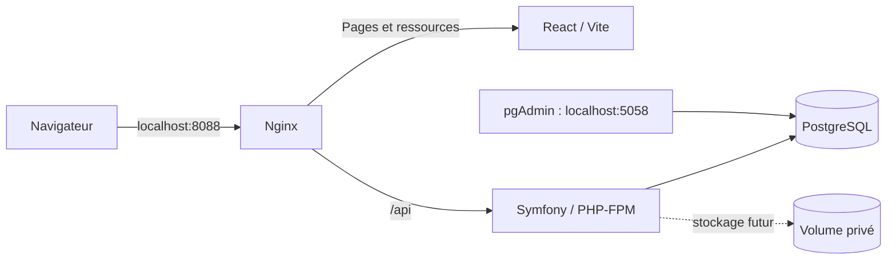

# Architecture technique

## Exécution locale

Le navigateur accède au front et à l'API par la même origine. PostgreSQL, PHP et Vite ne publient pas de port sur Windows. Les deux ports publiés sont liés à 127.0.0.1. Compose crée le réseau `datashare_default` et des volumes préfixés par `datashare_`.

La base contient actuellement `app_user` et la table technique des migrations Doctrine. `app_user` contient un UUID, un e-mail normalisé unique, un hash de mot de passe et une date de création en UTC. La base `datashare_test` est réservée aux tests PHP.

## Modèle cible et évolutions

| Table | Rôle | État |
| --- | --- | --- |
| app_user | Comptes et authentification | Implémentée |
| stored_file | Propriétaire, nom, taille, MIME, clé privée, jeton de partage, création, expiration, état de stockage | À implémenter |
| tag | Libellé de 1 à 30 caractères, propriétaire et libellé normalisé | Option US08 |
| file_tag | Association entre fichier et tag ; clé composée unique | Option US08 |

Le modèle cible prévoit un propriétaire facultatif pour les dépôts anonymes US07, un hash facultatif du mot de passe de partage US09 et `expires_at` pour les règles d'expiration. Le MVP exigera toujours un utilisateur connecté pour déposer un fichier. Les tags sont envisagés par propriétaire, avec unicité du libellé normalisé pour chaque utilisateur. Les fichiers et leurs tags devront appartenir au même propriétaire.

Ces possibilités seront ajoutées par des migrations ciblées lors de leur développement. Les options ne sont pas activées par l'authentification actuelle.

## Consultation et téléchargement

La future page `/s/{token}` appellera `GET /api/shares/{token}` pour les métadonnées. Le fichier sera envoyé seulement après un clic, par `GET /api/shares/{token}/download`. Les deux routes vérifieront l'expiration et l'éventuelle protection. Elles ne seront pas subordonnées au JWT d'un compte destinataire.

Les fichiers seront stockés hors du dossier public. Le volume est réservé dans Compose, sans route de dépôt active pour l'instant.

## Points à arbitrer avant les fichiers

- Répartition de la personnalisation de l'expiration et de la purge entre US01 et US10.
- Conservation éventuelle d'un historique expiré face à la suppression des métadonnées.
- Types de fichiers interdits et convention précise de la limite de 1 Go.
- Dépôt multiple et portée définitive des tags.
